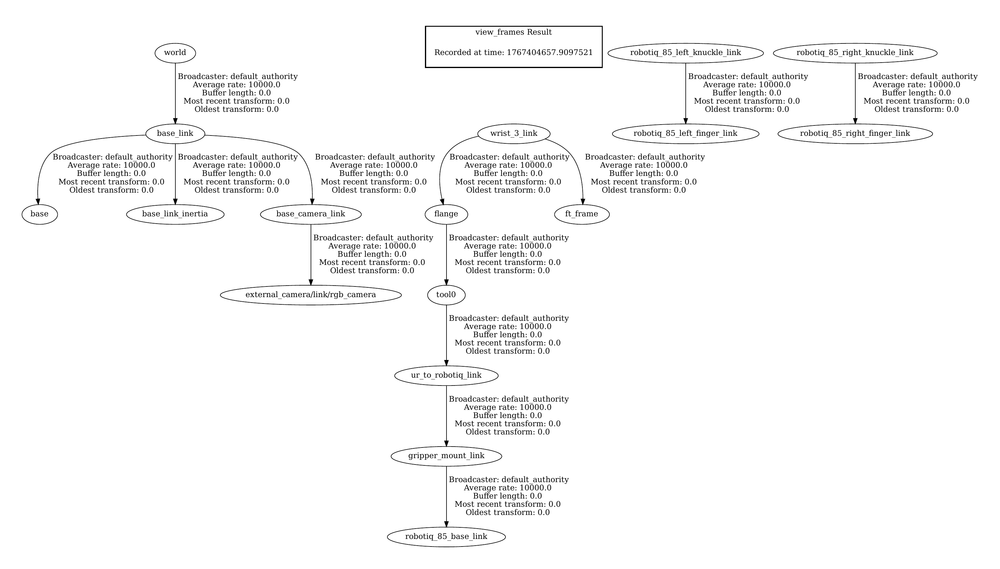
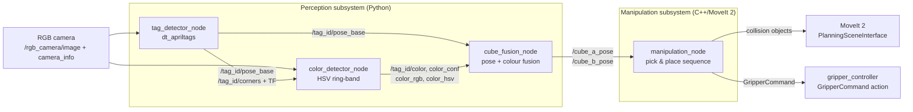
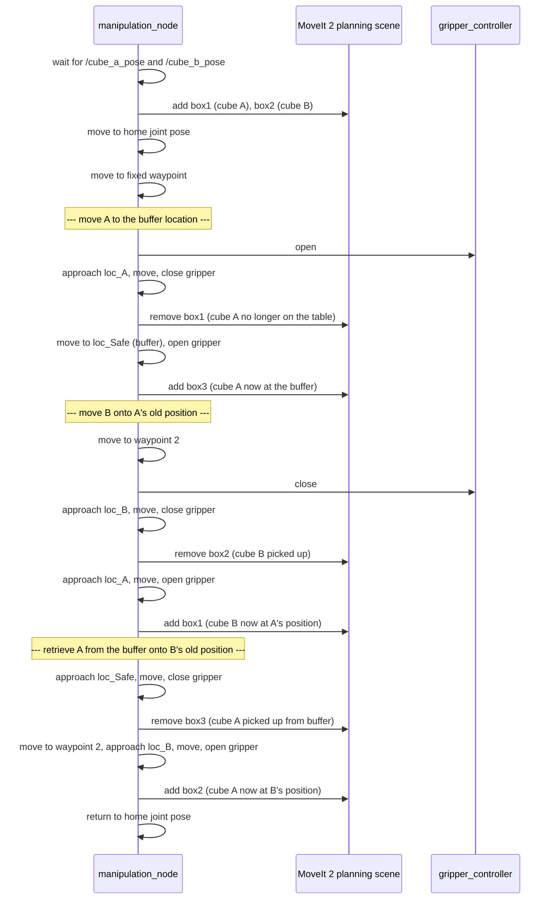

# UR5 Vision-Guided Manipulation

A ROS 2 pipeline that lets a simulated **UR5** arm autonomously **swap two
AprilTag-labelled cubes**, using only an RGB camera and AprilTag detection to
work out where they are and what colour they are.

Perception and manipulation are deliberately **decoupled subsystems** that meet at
a single pose/colour interface: a C++ MoveIt 2 node consumes the fused cube poses
and executes a constraint-aware pick-and-place sequence.

> The package retains its original course name (`group29_assignment_2`) so that it
> stays consistent with the accompanying report and the original commit history.
> See [`docs/CHANGES.md`](docs/CHANGES.md) for the edits made during preparation.

---

## Contents

- [Overview and objectives](#overview-and-objectives)
- [Features](#features)
- [Demo](#demo)
- [System architecture](#system-architecture)
- [How it works](#how-it-works)
- [Repository layout](#repository-layout)
- [Technologies and dependencies](#technologies-and-dependencies)
- [Installation and build](#installation-and-build)
- [Running the system](#running-the-system)
- [Configuration](#configuration)
- [Results](#results)
- [Known limitations](#known-limitations)
- [Reproducibility status](#reproducibility-status)
- [My contribution](#my-contribution)
- [Licence and acknowledgements](#licence-and-acknowledgements)

---

## Overview and objectives

Manipulation pipelines break in two places: when perception is wrong about *where*
something is, and when motion planning ignores what else is in the scene. This
project addresses both by splitting the problem into a perception subsystem that
produces a stable, timestamped answer about each cube, and a manipulation
subsystem that plans around a collision scene which it keeps in sync with reality.

The objectives were to:

1. detect two AprilTags and recover each cube's 6-DoF pose from a single RGB
   camera,
2. determine each cube's **colour** from the image region around its tag,
3. fuse pose and colour into one stable interface a controller can consume,
4. execute a full **cube swap** — two pick-and-place operations — with MoveIt 2,
   and
5. keep the planner aware of the cubes as **collision objects** that move as the
   task progresses.

Everything runs in **simulation** on a UR5 arm with a Robotiq 85 gripper.

## Features

- **Tag-based cube localisation** using `dt_apriltags` with `estimate_tag_pose`,
  converting the detection's rotation matrix into a quaternion and broadcasting
  each tag as its own TF frame.
- **Ring-band colour classification** — instead of sampling the tag (which is
  black and white), it samples an annulus *around* the tag, which is the cube
  face. This makes the colour estimate independent of tag orientation.
- **Achromatic handling before hue classification**, so black, white and grey are
  classified on saturation and value rather than being forced into a hue bucket.
- **A quantitative confidence value** per colour decision, from the peak of the
  hue histogram.
- **Stale-pose management**: the fusion node republishes a *fresh* pose within
  0.6 s and falls back to a "last known good" pose for up to 3 s, so the planner
  never blocks on a momentarily missed detection.
- **Collision-aware planning**: cube collision objects are added to the planning
  scene and added/removed as the cubes are picked, carried and placed.
- **Orientation constraints** that hold the gripper vertical throughout the
  approach and depart motions.
- **Explicit failure handling** — the gripper action client times out its goal
  handle (5 s) and result (10 s) rather than hanging.

## Demo

| Demonstration | Shows |
|---|---|
| `Manipulation.mp4` | The full cube-swap sequence in simulation |

Public video folder:
**<https://drive.google.com/drive/folders/1hunotXlMFh6AQY6Q9B9w4cY3GzINZ1f5>**

A real transform tree captured during a run is included below (source: ROS 2
`view_frames`). It shows the UR5 base, inertia and Robotiq 85 gripper frames live
at runtime — evidence that the arm model and the gripper chain were correctly
connected when the pipeline ran.



No rviz or camera screenshots exist in the original repository; none were
invented for this one. The colour classifier's output *is* observable at runtime
as numeric RGB/HSV values on `/tag_<id>/color_rgb` and `/tag_<id>/color_hsv`.

## System architecture

Four nodes across two subsystems. The subsystems share nothing but the fused
cube interface.



### Interface reference

Derived directly from the source.

| Endpoint | Type | Direction | Node | Purpose |
|---|---|---|---|---|
| `/rgb_camera/image` | `sensor_msgs/Image` | sub | tag_detector, color_detector | camera stream |
| `/rgb_camera/camera_info` | `sensor_msgs/CameraInfo` | sub | tag_detector | intrinsics (`fx, fy, cx, cy`) for PnP |
| `/tag_<id>/pose_base` | `geometry_msgs/PoseStamped` | pub / sub | tag_detector → cube_fusion | tag pose in `base_link` |
| `/tag_<id>/corners` | `geometry_msgs/PolygonStamped` | pub / sub | tag_detector → color_detector | tag corners in the image, defines the ROI |
| `/tag_<id>/color` | `std_msgs/String` | pub / sub | color_detector → cube_fusion | colour name |
| `/tag_<id>/color_conf` | `std_msgs/Float32` | pub / sub | color_detector → cube_fusion | histogram-peak confidence |
| `/tag_<id>/color_rgb` | `std_msgs/String` | pub / sub | color_detector → cube_fusion | mean RGB, for inspection |
| `/tag_<id>/color_hsv` | `std_msgs/String` | pub / sub | color_detector → cube_fusion | mean HSV, for inspection |
| `/cube_a_pose` | `geometry_msgs/PoseStamped` | pub / sub | cube_fusion → manipulation | fused pose of cube A (tag 1) |
| `/cube_b_pose` | `geometry_msgs/PoseStamped` | pub / sub | cube_fusion → manipulation | fused pose of cube B (tag 10) |
| `tag_<id>` | TF frame | broadcast | tag_detector | tag frame in the camera frame |
| `/gripper_controller/gripper_cmd` | `control_msgs/action/GripperCommand` | action client | manipulation | open / close gripper |

Tag IDs are `1` (cube A) and `10` (cube B), configurable via the `tag.ids`
parameter.

## How it works

### 1. Tag detection and pose recovery

`tag_detector_node` runs the `dt_apriltags` detector on each frame. Camera
intrinsics arrive separately on `/rgb_camera/camera_info` and are held until
`fx`/`fy` are non-zero, so the first frames are safely skipped rather than
producing a pose from a zero focal length.

For each detected tag it publishes, in this order:

1. the four corners as a `PolygonStamped` (used downstream as the colour ROI),
2. the tag as a **TF frame**, so other nodes can transform against it, and
3. the pose **transformed into `base_link`** using the camera-to-base transform.

Two details are worth noting. The detection's rotation matrix is converted to a
quaternion with an explicitly branched, numerically-stable routine, with the trace
case split from the three off-diagonal cases and a final normalisation guard
against a zero-norm quaternion. And the transform lookup first tries the **image
timestamp**, falling back to the **latest available** transform only if that
fails — so it prefers temporal correctness but does not drop frames when the
camera and the robot clock disagree slightly.

### 2. Colour classification from the ring around the tag

This is the most interesting piece of the perception stack. The tag itself is
black and white, so sampling inside the tag boundary tells you nothing about the
cube. `color_detector_node` therefore samples a **band around** the tag.

The mask is built geometrically: fill the tag corner polygon to make a solid
shape, dilate it by an inner kernel (6 px) and by an outer kernel (25 px), then
take `outer AND NOT inner`. The result is an annulus hugging the tag, which lands
on the cube face regardless of how the tag is rotated in the image.

The ROI is the tag's bounding box expanded by a factor of **0.7**, computed from
the corners received on `/tag_<id>/corners`.

Classification order matters and is handled deliberately:

```
1. reject the frame if fewer than 60 band pixels survive
2. compute mean H, S, V and mean R, G, B over the band
3. if S < 35  -> achromatic:  V < 70 -> "black",  V > 185 -> "white",  else "gray"
4. otherwise  -> keep pixels with S >= 10, build a 180-bin hue histogram,
                 confidence = peak_count / total,
                 name = classify_hue(mean hue)
```

Deciding achromaticity *before* hue classification is what stops a grey cube from
being reported as an arbitrary colour. Hue thresholds:

| Hue (OpenCV 0–179) | Colour |
|---|---|
| 0–10 or 170–179 | red (wraps around 0, as red does) |
| 11–25 | orange |
| 26–35 | yellow |
| 36–85 | green |
| 86–135 | blue |
| 136–169 | purple |

### 3. Fusing pose and colour into a stable interface

`cube_fusion_node` subscribes to the pose, colour, confidence and raw RGB/HSV
streams for both tags and republishes them on `/cube_a_pose` and `/cube_b_pose` at
**10 Hz**, on a timer rather than on arrival. That inverts the usual dependency:
the consumer is guaranteed a regularly-updated pose even when detections are
intermittent.

Two windows govern this:

| Parameter | Default | Behaviour |
|---|---|---|
| `pose_timeout_sec` | 0.6 s | a pose younger than this is "fresh" |
| `backup_hold_sec` | 3.0 s | a pose younger than this is still republished as last-known-good |

Poses older than 3 s stop being published entirely, so the controller cannot act
on a stale location indefinitely. It also logs a one-line human-readable summary
per cube per second — colour, confidence, RGB, HSV and XYZ — which is how the
classifier was tuned.

### 4. The cube-swap sequence

`manipulation_node` is a C++17 node that spins on a separate thread and then
executes a fixed, constraint-aware sequence. The swap A↔B genuinely needs a
**third location**, because the arm cannot place one cube where another still
sits:



The planning scene is therefore not static furniture: `box1`, `box2` and `box3`
are added and removed in step with the physical task, so the planner never tries
to plan through an object that has moved.

Each cube is approached from **35 mm above** its pose and departed the same way,
with the cube's own height offset applied to the grasp target. Gripper commands
are issued through the `GripperCommand` action with a maximum effort of 20 N, and
every goal handles both the goal-handle and the result future with explicit
timeouts so a missing controller fails loudly instead of hanging.

### 5. Keeping the gripper vertical

Before every move, an `OrientationConstraint` is attached to the path:

| Field | Value |
|---|---|
| `link_name` | `tool0` |
| tolerances (x, y, z) | 0.9, 0.9, 3.14 rad |
| `weight` | 1.0 |

This constrains `tool0` to the orientation the arm happened to hold when the
sequence started, which was vertical. The tolerances are **loose** — 0.9 rad is
about 51° — so this is a soft preference rather than a hard verticality guarantee.
It is worth reporting accurately rather than restating it as a strict constraint.
The constraints are cleared (`clearPathConstraints`) after each move so they do
not leak into the next plan.

Planning group is `ir_arm`, reference frame `base_link`, planning time 5 s, and
velocity/acceleration scaling are both set to 1.0.

## Repository layout

```
ur5-vision-guided-manipulation/
├── README.md
├── LICENSE                     Apache-2.0
├── CONTRIBUTORS.md
├── docs/
│   ├── CHANGES.md              every edit made during preparation
│   ├── RUNNING.md              what the external launch must provide
│   ├── AI_USAGE_DISCLOSURE.md  carried over from the report
│   ├── figures/
│   │   └── tf_tree_ur5_run.png / .pdf
│   └── reports/
│       └── Group29_Assignment2_Report.pdf
└── src/                        <- colcon workspace root
    └── group29_assignment_2/
```

The repository root **is** the colcon workspace.

## Technologies and dependencies

| Layer | Used |
|---|---|
| Middleware | ROS 2 (`rclpy` and `rclcpp`) |
| Motion planning | MoveIt 2 — `MoveGroupInterface`, `PlanningSceneInterface`, `OrientationConstraint` |
| Gripper control | `control_msgs/action/GripperCommand` via `rclcpp_action` |
| Tag detection | `dt_apriltags` (pure-Python AprilTag 3 detector, pip-installed) |
| Vision | OpenCV (`cv2`), `cv_bridge`, NumPy |
| Transforms | `tf2_ros`, `tf2_geometry_msgs` |
| Messages | `geometry_msgs`, `sensor_msgs`, `std_msgs`, `moveit_msgs`, `shape_msgs`, `control_msgs`, `rclcpp_action` |
| Simulation | Gazebo, UR5 with Robotiq 85 gripper |
| Build | `ament_cmake`, `colcon`, C++17 |

A full machine-readable list is declared in the package's `package.xml`. The
preparation pass **added dependencies the code imports but the original manifest
omitted** — including `rclpy`, `sensor_msgs`, `std_msgs`, `tf2_ros`, `cv_bridge`,
`python3-opencv`, `python3-numpy`, `moveit_msgs` and `shape_msgs`. See
[`docs/CHANGES.md`](docs/CHANGES.md).

## Installation and build

```bash
# 1. ROS 2, MoveIt 2, and the vision dependencies
sudo apt install ros-$ROS_DISTRO-moveit ros-$ROS_DISTRO-cv-bridge \
                 ros-$ROS_DISTRO-vision-opencv python3-opencv python3-numpy
pip install dt-apriltags          # not a rosdep key

# 2. This workspace
git clone https://github.com/alishavakhi/ur5-vision-guided-manipulation.git
cd ur5-vision-guided-manipulation
source /opt/ros/$ROS_DISTRO/setup.bash
rosdep install --from-paths src --ignore-src -r -y
colcon build --symlink-install
source install/setup.bash
```

> **ROS 2 distribution:** as with the companion repository, no distribution is
> declared anywhere in the original source, launch files or report. It has **not
> been guessed**. Note that `nav2_msgs` / MoveIt 2 APIs and
> `control_msgs/GripperCommand` have shifted between Humble and Jazzy, so this
> matters. See [Reproducibility status](#reproducibility-status).

## Running the system

The launch file expects an external **`ir_launch`** package that starts Gazebo,
the UR5 and MoveIt 2 — course-provided and **not** included here. See
[`docs/RUNNING.md`](docs/RUNNING.md).

With `ir_launch` available:

```bash
ros2 launch group29_assignment_2 assignment2.launch.py
```

The launch file starts the perception nodes with `use_sim_time: true` and
schedules `manipulation_node` **2 seconds later** via `TimerAction`, giving the
perception stack time to publish before the planner starts asking for cube poses.

## Configuration

Colour classification is fully parameterised, so thresholds can be retuned
without touching code:

| Parameter | Default | Role |
|---|---|---|
| `roi_expand` | 0.7 | ROI padding as a fraction of the tag bounding box |
| `band_inner_px` | 6 | inner dilation — how far to stay off the tag |
| `band_outer_px` | 25 | outer dilation — how far out the sampled band reaches |
| `min_pixels` | 60 | minimum band pixels for a valid decision |
| `hsv_s_min` | 10 | saturation floor for chromatic pixels |
| `neutral_s_max` | 35.0 | below this the pixel counts as achromatic |
| `black_v_max` | 70.0 | achromatic and darker than this ⇒ black |
| `white_v_min` | 185.0 | achromatic and brighter than this ⇒ white |

Fusion and detection parameters: `pose_timeout_sec` (0.6), `backup_hold_sec`
(3.0), `publish_rate_hz` (10.0), `print_period_sec` (1.0), `camera_info_topic`,
`image_topic`, `base_frame` (`base_link`), `z_offset` (0.03), `tag_frame_prefix`
(`tag_`), `tag.ids` (`[1, 10]`), plus the full `dt_apriltags` detector block
(`threads`, `decimate`, `blur`, `refine`, `sharpening`, `debug`, `publish_tf`).

## Results

Stated precisely, because this project produced a **binary outcome** rather than a
scored one.

**Evidenced:**

- The full swap sequence executes in simulation — the task's goal, a successful
  two-cube exchange, is reported as achieved in the accompanying report.
- The perception subsystem produced stable cube poses: the fusion node's
  last-known-good window exists precisely because detections do drop out, and the
  planner treats a 3 s-old pose as usable.
- The classifier reports a **numeric confidence** (hue-histogram peak fraction) for
  every decision, and logs RGB/HSV means continuously — so its behaviour is
  inspectable rather than a black box.
- The transform tree in [`docs/figures/`](docs/figures/) was captured live.

**Not measured — and not claimed:**

- No success rate, no cycle time, no planning time, no colour-classification
  accuracy and no positional error figure exists anywhere in the source, the
  report or the git history. None are invented here.
- Colour accuracy in particular would be easy to quantify (the classifier already
  emits a confidence per frame, and the tag ID determines the ground-truth
  colour), which makes it the most valuable next measurement. It is listed under
  [Known limitations](#known-limitations).

## Known limitations

Recorded from reading the code; none of these were changed during preparation.

1. **External `ir_launch` dependency.** The launch file is not self-contained —
   it delegates Gazebo, the UR5 model and MoveIt 2 bringup to a course package
   that is not included. See [`docs/RUNNING.md`](docs/RUNNING.md).
2. **The manipulation sequence is hard-coded to the scene.** Grasp offsets,
   the buffer location (`loc_Safe` = cube A offset by −0.07, +0.1, +0.15 m), the
   two waypoints, the home joint values and the collision-box dimensions are all
   literals. It solves *this* scene well; it is not a general pick-and-place
   planner. Worth stating plainly rather than implying generality.
3. **Orientation constraint is loose.** Tolerances of 0.9/0.9/3.14 rad keep the
   gripper roughly vertical, not strictly vertical.
4. **Colour name and confidence come from different statistics.** The name is
   derived from the *mean* hue, while the confidence is the *peak* of the hue
   histogram. On a bimodal band they can disagree — a confident peak alongside a
   mean that lands in another bucket. Using the peak bin's colour would make the
   two consistent.
5. **The manipulation node assumes `base_link`.** Every pose and the collision
   objects are stamped in `base_link`, which is correct for a fixed-base arm but
   is written as a literal in two places rather than a parameter.
6. **Single-shot operation.** The sequence runs once and then calls
   `rclcpp::shutdown()`. There is no service or action interface to request
   another swap.
7. **Detector tuning is fixed** in the parameter defaults; `dt_apriltags` is
   invoked per frame at full image resolution with `decimate = 2.0`.

## Reproducibility status

| Check | Status |
|---|---|
| Python syntax of the three perception nodes | **verified** (`python3 -m py_compile`) |
| `package.xml` well-formed and consistent | **verified** (parsed; dependencies cross-checked against imports) |
| `CMakeLists.txt` targets match the files present | **verified by inspection** — `manipulation_node` (C++) plus three installed Python programs |
| Node/topic/action names in this README | **verified** against source |
| `colcon build` (including the C++ node) | **NOT TESTED** — no ROS 2 or MoveIt 2 installation was available |
| Launching the simulation | **NOT TESTED** |
| ROS 2 distribution | **UNDETERMINED** — not declared anywhere in the original repository |
| Reported swap success | from the report and video, not independently reproduced |
| No quantitative results | none exist to reproduce |

The C++ node in particular was **read, not compiled**. Its MoveIt 2 and
`control_msgs` API usage could not be checked against a real toolchain.

## My contribution

This was a **two-person group project** (Group 29). Work is not presented here as
solely mine.

**Collaborators:** Ali Shavakhi, Vaheid Labbaf — co-authors of the accompanying
report.

Commit-level contribution to the original repository, by package:

| Package | Vaheid Labbaf | Ali Shavakhi | Reading |
|---|---|---|---|
| `group29_assignment_2` | **8 commits** | 6 commits | led by Vaheid Labbaf |

**This package was led by my teammate**, and the accompanying report describes the
architecture as jointly designed. I contributed to it and am a co-author; I am not
its principal author, and it is presented here as shared work with the split shown.

In the wider repository, across both assignments, I was the majority committer
(26 of 40 commits), and the Kalman-filtered estimator in the companion
[TurtleBot3 repository](https://github.com/alishavakhi/turtlebot3-navigation-perception)
is entirely my own work.

See [`CONTRIBUTORS.md`](CONTRIBUTORS.md).

## Licence and acknowledgements

Licensed under **Apache-2.0** — see [`LICENSE`](LICENSE). The original package
already carried this licence and declaration; it has been preserved.

**Scope of the licence:** Apache-2.0 covers the source code, configuration and
documentation in this repository. The academic report in
[`docs/reports/`](docs/reports/) is the authors' own work, included with the
co-author's consent. No third-party code is vendored: MoveIt 2, `dt_apriltags`,
OpenCV, `cv_bridge`, the UR5 description packages and Gazebo are consumed as
installed upstream packages under their own licences.

The full academic report is in
[`docs/reports/Group29_Assignment2_Report.pdf`](docs/reports/Group29_Assignment2_Report.pdf).

**AI usage disclosure** (carried over from the report, unchanged): portions of the
report text were supported by AI-based language models for improving clarity and
formatting. All system architecture decisions, perception logic, and ROS 2 code
were designed and implemented by the authors. See
[`docs/AI_USAGE_DISCLOSURE.md`](docs/AI_USAGE_DISCLOSURE.md).

Built on MoveIt 2, `dt_apriltags`, OpenCV, `cv_bridge`, the UR5 description
packages and Gazebo — all third-party projects under their own licences.
